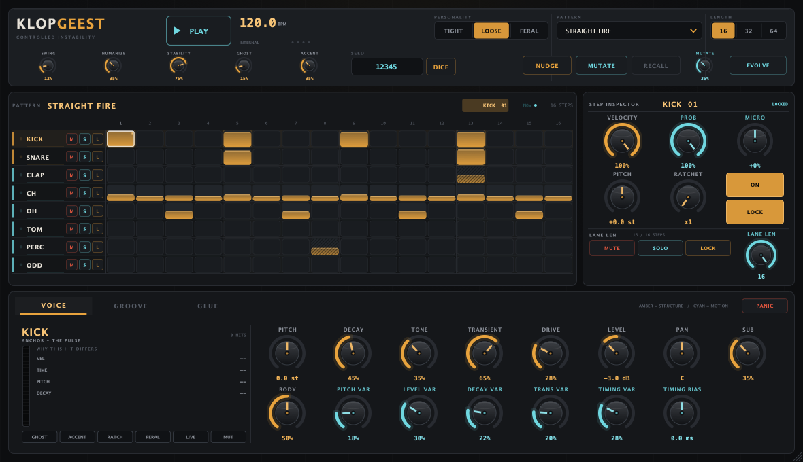

# KLOPGEEST

**An unruly rhythm instrument.** Eight synthesized drum voices, a sequencer that
understands groove, and an enormous analog-inspired glue machine — built to make
you get up and dance.

KLOPGEEST is a new, standalone JUCE instrument by **Master Lonn & Little Wan**,
for macOS 12+ in AU, VST3 and Standalone formats. It is an independent project,
informed by lessons from NAGLOED; no NAGLOED code is compiled into the
instrument. One GPL-3.0-or-later research copy of NAGLOED's SpectraStrobe
reference encoder and verifier is vendored under
`reports/spectrastrobe/reference/` as a test oracle — see the provenance note
there for the exact commit and why it is not part of the build.

> *klopgeest* (Dutch) — a mischievous spirit that knocks and rattles around the
> house. Not a ghost. Not a machine. Something in between that wants to be heard.

Status: **Milestone 1 complete — a groove that works.** Eight procedurally
synthesised voices, a host-synced sequencer with correlated humanisation and
deterministic seeds, mutation with recall, and the glue machine are built and
validated. Open milestones for the rest of the road are tracked as issues.



## What it is

A drum machine is a clock you can argue with. KLOPGEEST starts from a hard
16th-note grid and then bends it: correlated timing drift instead of random
jitter, ghost notes that answer accents, hats that lean while the kick stays
planted, and a GLUE/HEAT bus that makes the whole kit move as one physical
object.

It is not a sample-based 808/909 clone, not a generative music service, and not
a spreadsheet with knobs. It is eight voices of procedural analog-ish percussion,
a groove engine with three personalities, and a compressor section you will
probably overuse.

## The eight voices

| Voice | Character |
|---|---|
| **KICK** | Pitch-swept body, click transient, saturation, optional subharmonic emphasis. |
| **SNARE** | Tuned twin body, filtered noise, wire character, transient snap. |
| **CLAP** | Multitrigger noise bursts with diffusion and stereo width. |
| **CLOSED HAT** | Inharmonic metallic bank + noise; short, tight, choke source. |
| **OPEN HAT** | Related metallic engine with longer decay; choked by the closed hat. |
| **TOM** | Resonant tuned percussion with pitch bend and skin. |
| **PERC** | Morphs click → wood → metal → bell across its CHARACTER control. |
| **ODD** | Deliberately unstable oscillator/resonator; glitches with intent. |

Every voice has pitch, decay, transient/click, tone, drive, level and pan, plus
two voice-specific character controls. Each voice also has its own randomisation
depth for pitch, loudness, decay, transient and timing.

## The sequencer

- 16/32/64-step patterns on a 16th-note grid, variable length per lane
  (polyrhythms live here), 1–4 bar patterns.
- Per step: on/off, velocity/accent, probability, microtiming, pitch deviation,
  ratchets (1–4) and a lock that makes the step immune to humanisation.
- Host transport sync with sample-accurate scheduling; free-running internal
  clock for standalone/live use. Start, stop, seek and tempo changes follow the
  host.
- Deterministic performance seeds: the same seed reproduces the same take.
- Six factory patterns with distinct rhythmic personalities, from *STRAIGHT
  FIRE* to *SIXTEENTH ANXIETY*.

## Groove, not randomness

The **GROOVE** engine separates rhythmic structure from expressive deviation.

- Swing and per-voice timing bias.
- Correlated timing variations (value noise over the grid, not white jitter):
  neighbouring steps move together, so the groove breathes instead of
  twitching.
- Kick and snare are anchors and stay tighter; hats, percussion and ODD are
  allowed to wander further.
- Personalities: **TIGHT** (disciplined), **LOOSE** (relaxed, playful),
  **FERAL** (unstable but still intelligible).
- STABILITY dials the whole system from machine-like to barely contained.
- Locked steps and lanes are never randomised.

## The glue machine

A dedicated master bus, not a transparent limiter:

- Soft-knee compressor with threshold, ratio, attack, release, knee.
- Sidechain high-pass so the kick does not pump the whole bus.
- Blendable peak/RMS detection, auto-release, parallel (dry/wet) compression.
- Pre- and post-compression saturation, output gain and a safe ceiling limiter.
- **GLUE** macro: from gentle cohesion to aggressive pumping.
- **HEAT** macro: from restrained warmth to substantial harmonics.
- Smooth, metered gain reduction.

## Mutation

The **MUTATE** section changes the rhythm rather than replacing it:

- **NUDGE** — a small, reversible edit.
- **MUTATE** — a substantial variation that keeps the groove recognisable.
- **RECALL** — walk back through the mutation history.
- **EVOLVE** — let small mutations accumulate while locked anchors stay put.
- Mutation amount is a control, not a dice roll. Everything is seedable and the
  history is audible.

## Build

Requirements: macOS 12+, Xcode Command Line Tools, CMake 3.22+, git, curl.
JUCE 9.0.5 is vendored locally once, so the build itself never fetches anything.

```bash
./scripts/fetch-juce.sh      # once: JUCE 9.0.5 into .deps/JUCE
./scripts/build.sh           # AU + VST3 + Standalone + headless tool
```

Artifacts:

```
build/KLOPGEEST_artefacts/Release/AU/KLOPGEEST.component
build/KLOPGEEST_artefacts/Release/VST3/KLOPGEEST.vst3
build/KLOPGEEST_artefacts/Release/Standalone/KLOPGEEST.app
build/klop_tool_artefacts/Release/klop-tool
```

Install the plug-ins by copying the bundles:

```bash
cp -R build/KLOPGEEST_artefacts/Release/AU/KLOPGEEST.component ~/Library/Audio/Plug-Ins/Components/
cp -R build/KLOPGEEST_artefacts/Release/VST3/KLOPGEEST.vst3      ~/Library/Audio/Plug-Ins/VST3/
```

Builds in this repository are ad-hoc signed, not notarised. If a host refuses
to load a locally built component, rescan its plug-in folders or restart it.

## Play it

1. Open the Standalone app and press **PLAY** (or load the plug-in in a host and
   start the host transport).
2. Pick a factory pattern; press **PLAY**. Adjust **SWING**, **HUMANIZE** and
   **STABILITY**; switch **PERSONALITY** from TIGHT to FERAL.
3. Shape the selected voice with the voice panel; every knob has an immediate
   audible job.
4. Push **GLUE** until the kit locks; push **HEAT** until it glows. Watch the
   gain-reduction meter.
5. Press **NUDGE** or **MUTATE**; press **RECALL** if it gets too clever.
6. Hold a step's lock when you find something that must survive.

Live MIDI: notes **C1–G1 (36–43)** trigger the eight voices, velocity-sensitive.
All-notes-off / all-sound-off panic is honoured.

## Repository layout

```
src/core/        parameters, pattern data, deterministic RNG, visual telemetry
src/dsp/voices/  eight procedural drum voices
src/dsp/master/  the glue machine
src/sequencer/   transport, sample-accurate scheduling, groove engine, mutation
src/plugin/      JUCE processor glue, state, programs
src/ui/          performance editor
tests/           headless unit / DSP / state / timing tests
tools/           klop-tool: tests, offline render, offscreen UI snapshot
docs/            architecture, design tradeoffs, manual, validation, workshop
```

## Testing and validation

Measured on the Milestone 1 build (macOS 26.6.2, arm64, Apple Command Line Tools,
CMake 4.0, JUCE 9.0.5). Details, commands and limitations:
[docs/VALIDATION.md](docs/VALIDATION.md). Test strategy:
[docs/TESTING.md](docs/TESTING.md).

- **570 automated checks, 0 failures, 0 skipped** — voice DSP, groove/sequencer,
  glue machine, state recall, hostile parameter fuzzing, sample-rate sweep,
  block-size invariance and audio-thread allocation freedom.
- **Apple `auval`: PASS** for `aumu Klpg MLLW`.
- **pluginval strictness 10: PASS** on AU and VST3 (with editor open/close and
  parameter fuzzing).
- **Zero allocations** in `processBlock` after `prepareToPlay`.
- **Demo**: 48 s, peak −1.2 dBFS, no full-scale samples, finite; deterministic
  (same SHA-256 on repeated renders).
- **CPU**: full 48 s demo renders in ~0.54 s (≈90× realtime, ~1 % of one core at
  48 kHz stereo).
- **Not performed**: automated GUI sessions in REAPER/Ableton Live (hosts are
  installed; only `auval`/pluginval validation was run), notarisation, and
  universal-binary builds. This build is native arm64 and ad-hoc signed.

```bash
./scripts/validate.sh          # build, tests, demo render, snapshot, auval, pluginval 10
./scripts/validate.sh --quick  # skip pluginval (the slow part)
```

## Known limitations

- macOS 12+ only; the local build is arm64 (no universal binary yet).
- Ad-hoc signed, not notarised: hosts may require a rescan after install.
- No user sample loading yet (procedural voices only).
- No keyboard navigation or undo in the editor; 64-step patterns scroll
  horizontally; velocity is edited in the step inspector.
- DRIFT, BREATH, CONVERSATION, SCARS and FILL ME are deliberately deferred to
  keep the core instrument stable; they are tracked as issues.

## Workshop

This instrument is also a teaching artefact for a one-day AI-assisted
instrument-making workshop. [docs/WORKSHOP.md](docs/WORKSHOP.md) shows how to add
a voice, a modulation behaviour or a new rhythmic interaction without having to
understand the whole codebase — and where the maker's judgement matters more
than the model's.

## Credits

Built by Master Lonn & Little Wan. JUCE 9.0.5 (see JUCE licensing). GPL-3.0-or-later
for this repository. KLOPGEEST is an independent project; NAGLOED is untouched.
