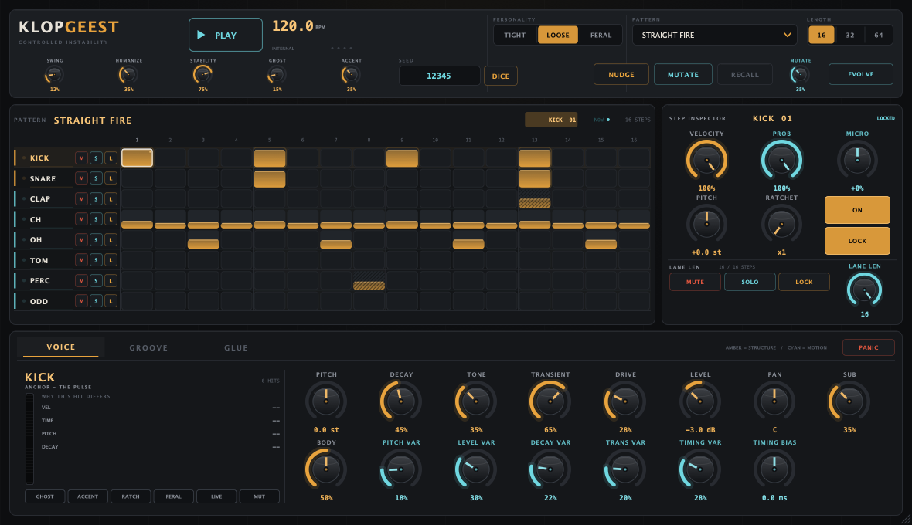

# KLOPGEEST — User Manual

> Manual for KLOPGEEST 0.1.0 (Milestone 1, macOS arm64). Controls and ranges are
> checked against `src/core/Parameters.h` / `src/core/EngineParams.h` and the
> voice/sequencer contracts; the editor screenshot is `docs/ui-preview.png` from
> the final editor. Release evidence and known limitations live in
> [VALIDATION.md](VALIDATION.md). Owner: QA workstream — send corrections rather
> than editing from other workstreams.

KLOPGEEST is a procedural drum machine: eight synthesized drum voices driven by a
deterministic groove engine and glued together by a bus compressor / saturation /
limiter chain. There are no samples. It is designed to feel like a drummer, not a
grid: timing, pitch, velocity, decay and texture deviation are part of the
instrument, controllable and repeatable.

The editor at its default 1180×680 size:



## 1. Signal flow

```
Pattern (16th grid)                     Performance controls
        │                                      │
        ▼                                      ▼
  Groove engine  ── deterministic deviation ──► Sequencer / transport
        │                                      │
        ▼                                      ▼
  Eight voices (kick … odd)  ── choke groups ──► mix bus
                                               │
                                               ▼
                         Glue machine (compressor → saturation →
                         parallel mix → ceiling limiter → meters)
```

The audio thread never allocates or locks. Pattern edits are published lock-free
from the GUI; the audio thread always plays the newest snapshot.

## 2. Voices

Eight permanent voice slots (indices are part of the save format and parameter
IDs):

| # | Voice | Character controls (`specialA` / `specialB`) |
| --- | --- | --- |
| 0 | KICK | SUB / BODY |
| 1 | SNARE | WIRES / NOISE |
| 2 | CLAP | DIFFUSION / WIDTH |
| 3 | CLOSED HAT | METAL / SIZZLE |
| 4 | OPEN HAT | METAL / CHOKE |
| 5 | TOM | BEND / SKIN |
| 6 | PERC | MODE / SPACE |
| 7 | ODD | CHAOS / RING |

Per-voice controls (same set for every voice, stable parameter IDs
`<voice>.<param>`, e.g. `kick.pitch`):

| Control | Range (default) | What it does |
| --- | --- | --- |
| PITCH | −24 … +24 st (0) | tuning of the voice |
| DECAY | 0 … 1 (0.45-ish) | tail length |
| TONE | 0 … 1 | dark ↔ bright |
| TRANSIENT | 0 … 1 | attack emphasis |
| DRIVE | 0 … 1 | per-voice saturation |
| LEVEL | −60 … +6 dB | output gain |
| PAN | −1 … +1 | stereo position |
| CHARACTER / TEXTURE | 0 … 1 | `specialA` / `specialB`, voice-specific (see table above) |
| PITCH VAR / LEVEL VAR / DECAY VAR / TRANS VAR / TIMING VAR | 0 … 1 | stochastic depth per dimension |
| TIMING BIAS | −25 … +25 ms | per-voice groove offset |

Voices are one-shot procedural synthesizers; closed hat chokes the open hat (a
classic hat choke, only tighter). `PITCH VAR` etc. define *how much* the groove
engine is allowed to bend a hit; the tuned ranges are musical ranges, not raw
randomness.

## 3. Factory patterns

Six factory rhythms double as starting points (selectable in the PATTERN menu
and exposed as programs to the host):

| # | Name | Character |
| --- | --- | --- |
| 0 | STRAIGHT FIRE | four-to-the-floor kick, offbeat open hats, a breath of percussion |
| 1 | BROKEN STEP | syncopated kick, displaced clap, hats that lean forward |
| 2 | GHOST POCKET | sparse anchor skeleton with ghost notes around it |
| 3 | WAREHOUSE | driving, larger room, harder accents |
| 4 | FERAL DUB | loose, dubby, heavy space |
| 5 | SIXTEENTH ANXIETY | busy sixteenth colour, nervous top end |

The exact step data lives in `src/core/Patterns.cpp`; the names are shown in the
editor and are stable IDs for host programs.

## 4. Pattern and steps

A pattern is a grid of up to 64 sixteenth-note steps (default 16; pattern length
16/32/64), eight lanes (one per voice). Each step has:

* **on/off**
* **velocity** (accent, 0.02 … 1)
* **probability** (0 … 1 chance it fires)
* **microtiming** (−0.5 … +0.5 of a step)
* **pitch** (−12 … +12 semitones)
* **ratchet** (1 … 4 sub-hits)
* **locked** (immune to humanisation and mutation)

Per lane: length, mute, solo, lock (ignore humanisation for that voice).

Factory rhythms double as programs (6 patterns). The pattern is saved with the
host session and restored exactly.

## 5. Performance controls

| Control | Range (default) | What it does |
| --- | --- | --- |
| TEMPO | 60 … 200 BPM (120) | free-run tempo; ignored while a host transport is playing |
| SWING | 0 … 0.75 (0.12) | delayed off-beats, correlated across voices |
| HUMANIZE | 0 … 1 (0.35) | overall stochastic depth (timing, pitch, level, decay) |
| STABILITY | 0 … 1 (0.75) | 1 = machine-tight, lower = human |
| PERSONALITY | TIGHT / LOOSE / FERAL | how far the groove engine is allowed to push, and how |
| GHOST | 0 … 1 (0.15) | depth of ghost-note interaction between voices |
| ACCENT | 0 … 1 (0.35) | accent shaping depth |
| SEED | 0 … 999999 (12345) | deterministic performance seed: same seed = same render |
| MUTATE AMOUNT | 0 … 1 (0.35) | how strongly NUDGE / MUTATE change the pattern |
| EVOLVE | on/off | accumulate small pattern mutations over repetitions |

Transport: **Play/Stop** runs the internal clock when the host has no running
transport (Standalone, or host stopped). With a host transport the sequencer
follows host BPM and song position, including seeks and loops. **PANIC**
immediately silences the voices.

## 6. Pattern actions

* **NUDGE** — one small, recallable change to the pattern.
* **MUTATE** — a bigger stochastic pattern variation.
* **RECALL** — undo the last NUDGE/MUTATE (recall is available while `canRecall`).
* **Load factory pattern / program** — replaces the current pattern with a
  factory rhythm and resets mutation history.

All editing happens on the message thread; the audio thread never waits.

## 7. Glue machine (master bus)

Not a transparent compressor. Controls (parameter IDs `master.*`):

| Control | Range (default) | What it does |
| --- | --- | --- |
| THRESHOLD | −60 … 0 dB (−18) | compression threshold |
| RATIO | 1 … 20 (4) | compression ratio |
| ATTACK | 0.1 … 100 ms (8) | attack time |
| RELEASE | 20 … 1200 ms (180) | release time |
| KNEE | 0 … 24 dB (8) | soft-knee width |
| AUTO RELEASE | on/off | programme-dependent release |
| SIDECHAIN HPF | 20 … 500 Hz (90) | sidechain high-pass, keeps the kick from pumping the whole bus |
| DETECT | 0 … 1 (0.5) | 0 = peak, 1 = RMS detection |
| MIX | 0 … 1 (1) | parallel compression blend |
| SAT PRE / SAT POST | 0 … 1 | saturation before / after compression |
| OUTPUT | −24 … +12 dB | output trim |
| CEILING | −12 … 0 dB (−0.4) | limiter ceiling |
| LIMITER | on/off | performance ceiling limiter |
| GLUE | 0 … 1 (0.35) | performance macro: compression + parallel blend |
| HEAT | 0 … 1 (0.25) | performance macro: saturation + drive |

## 8. Live MIDI input

The plug-in saves the complete parameter state plus the current pattern (and its
pattern index) with the host session. Factory patterns are programs; user
presets are host sessions. The save format is versioned; never rename parameter
IDs (they are host automation identities).

## 9. Groove concepts (why it feels like a drummer)

* **Humans are correlated, not random.** The groove engine's timing movement is
  value noise over the tick index (`src/core/Random.h`), so hats drift *together*
  over a bar instead of each hit jittering on its own. Raising HUMANIZE widens
  every stochastic dimension; STABILITY pulls them back toward machine-tight.
* **Rhythm roles matter.** The kick and snare are anchors; they are kept much
  tighter than hats/perc/odd (`kVoiceRoleLoose` in `src/core/Constants.h`).
  PERC/ODD carry the loose, human colour.
* **PERSONALITY is a policy, not a preset.** TIGHT clamps deviations hard. LOOSE
  lets the grid breathe. FERAL pushes timing/pitch/decay far but still clamps
  each hit, so the pulse stays intelligible.
* **SWING is grid feel; HUMANIZE is deviation.** Swing delays the odd 16ths by a
  fraction of a step, consistently, for every voice. Humanize adds the
  non-uniform movement on top.
* **The seed owns the performance.** All stochastic decisions are a pure
  function of `(seed, voice, tick, salt)`. Same seed + same edit = same
  performance, always; change SEED (or press DICE) to get a different human.
* **The instrument explains itself.** The editor's "WHY THIS HIT DIFFERS" readout
  shows the last hit's velocity, timing deviation, pitch deviation and decay
  scale, and the flag row (GHOST / ACCENT / RATCH / FERAL / LIVE / MUT) says
  which mechanism bent it.

## 10. MIDI note map

The plug-in is an instrument: notes C1 (MIDI 36) to G1 (MIDI 43) trigger the
eight voices live, on any MIDI channel. Velocity is used as the trigger velocity
(0.02…1.0). Live hits go through the same render path as sequenced hits and are
marked LIVE in the visual flags. Notes outside 36…43 are ignored. There is no
MIDI output; `All Notes Off` / `All Sound Off` resets the voices.

| Note | Voice |
| --- | --- |
| C1 (36) | KICK |
| C#1 (37) | SNARE |
| D1 (38) | CLAP |
| D#1 (39) | CLOSED HAT |
| E1 (40) | OPEN HAT |
| F1 (41) | TOM |
| F#1 (42) | PERC |
| G1 (43) | ODD |

## 11. Tips

* Start with a factory pattern, set PERSONALITY to TIGHT, then move to LOOSE and
  FERAL at the same SEED to hear what the groove engine is doing.
* SWING and HUMANIZE interact: big swing + high humanize can push late hats off
  the grid entirely; lower STABILITY if it feels drunk, raise it for precision.
* The glue machine's kick interaction lives in SIDECHAIN HPF and ATTACK: fast
  attack + high HPF = punch; slow attack + low HPF = glue.
* EVOLVE + a high MUTATE AMOUNT turns the instrument into a slowly drifting
  player; RECALL is your way back.
* Same SEED = same performance. Render it once and it is reproducible forever.

## 12. Troubleshooting

| Symptom | Likely cause |
| --- | --- |
| No sound from the sequencer | transport stopped; press Play (or start the host transport) |
| No sound at all | level/pan or mute/solo state; check PANIC is not stuck; check the master limiter/output |
| Output distorted | lower DRIVE / SAT PRE / HEAT, or raise the CEILING (less limiting) |
| Pattern edits not heard | the GUI publishes snapshots lock-free; a full queue drops the oldest edit — the newest edit wins |
| Groove feels wrong at high tempo | reduce SWING/HUMANIZE, raise STABILITY, or use TIGHT |
| AU does not appear in the host | install `KLOPGEEST.component` into `~/Library/Audio/Plug-Ins/Components` and restart the host/registrar |

## 13. Validation status

See [VALIDATION.md](VALIDATION.md) for the full evidence table. Status at the
time of writing (Milestone 1, macOS arm64, ad-hoc local builds):

- Headless suite: **570 checks, 0 failures, 0 skipped** (all five suites).
- Demo render: 48.0 s, **−1.20 dBFS** peak, 0 full-scale samples, finite,
  deterministic (SHA-256 `d5e1302282268585f7db370e88e1d4a96a4c4681b5477958b0a1751092285ffc`).
- VST3 pluginval strictness 10: **PASS** (21/21 tests, seed `0x3eafa08`).
- AU `auval -v aumu Klpg MLLW`: **AU VALIDATION SUCCEEDED** on the final
  installed build (170 PASS groups; log `build/validate-logs/auval-final.log`).
- AU and VST3 pluginval strictness 10 **with GUI tests**: **PASS** (25/25 each,
  seed `0x3eafa08`; logs `build/validate-logs/pluginval-au-final.log`,
  `pluginval-vst3-final.log`).
- Manual DAW host session: **not performed** — no host GUI session was run for
  this milestone; that is recorded as a limitation rather than claimed.

No marketing claim here is made without the corresponding measurement above.
